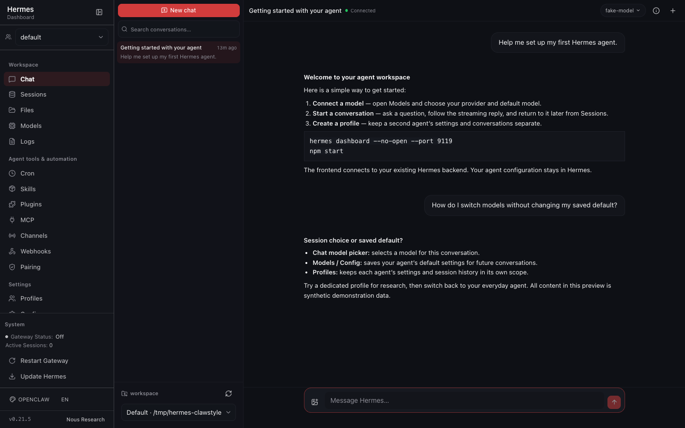
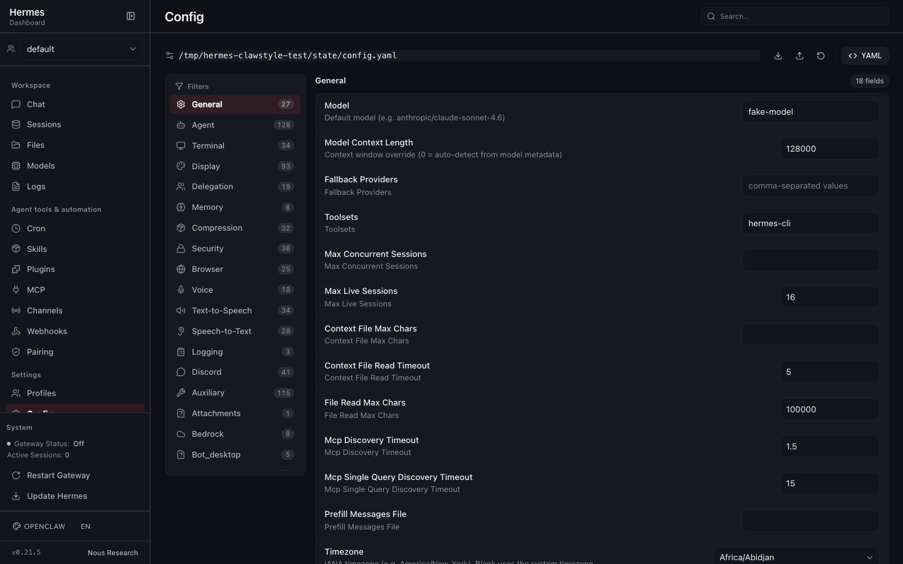
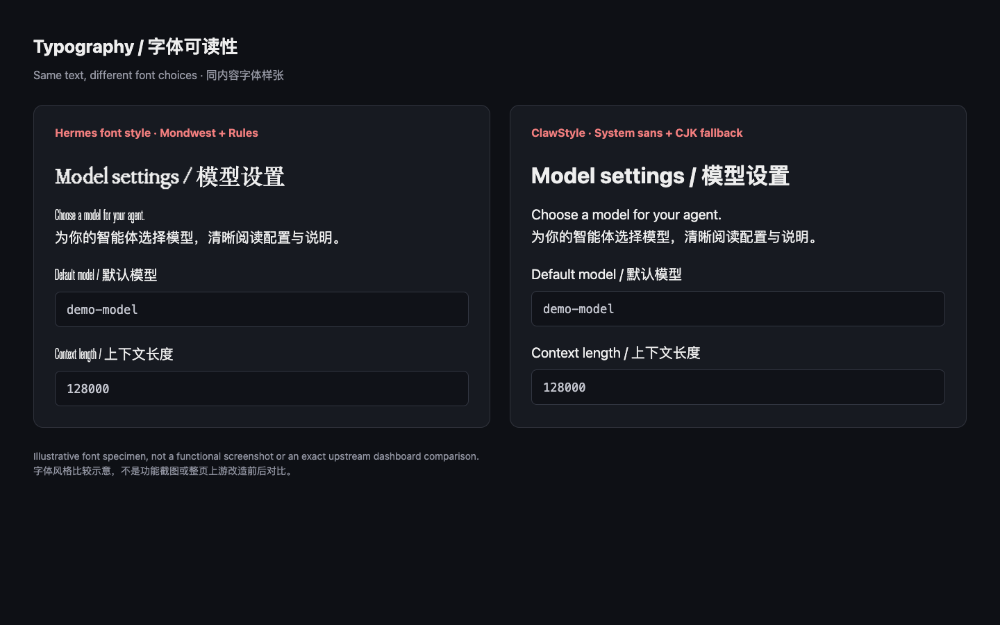

# ClawStyle UI

**English** | [简体中文](README.zh-CN.md)

**An OpenClaw-style alternative frontend for Hermes Dashboard, built to improve usability, typography, navigation, and everyday chat and agent configuration.**

**Unofficial, community-built alternative frontend for the [Hermes Agent](https://github.com/NousResearch/Hermes-Agent) dashboard.**
Same backend, REST/WebSocket protocol, authentication and profile isolation — a redesigned browser
experience with native structured chat, readable system typography and grouped navigation. Not
affiliated with, endorsed by, or supported by Nous Research or the Hermes Agent maintainers.

## Preview

| Chat | Model & config |
| --- | --- |
|  |  |

*(Screenshots use synthetic data only, with the ClawStyle theme active.)*

[Chinese interface](docs/assets/chat-preview.zh-CN.png) · [Mobile preview](docs/assets/mobile-preview.png) · [Screenshot notes](docs/assets/README.md)

## Why another frontend?

We built this because we found the original control panel harder to use than it needed to be. In particular, its decorative fonts made labels and mixed-language text harder for us to scan. Its presentation favors decorative display
faces for headings and labels, dense chrome, a single long navigation list, and a terminal-based
default chat. This project keeps everything users rely on — the backend, protocol, auth and
profiles — and redesigns only the browser experience:

- **Readability first.** UI text renders in a neutral system sans with explicit Simplified Chinese /
  Japanese / Korean fallbacks; code, IDs and the optional console stay in a real monospace stack.
  Display-font utilities inherited from the design system are remapped to the active theme, so text retains system fallbacks
  when optional webfonts fail to load.
- **Navigation that can be scanned.** Settings and agent tools are grouped (`Workspace`,
  `Agent tools & automation`, `Settings`) in a persistent, collapsible sidebar shared across routes.
- **Native browser chat.** The default `/chat` is a structured JSON-RPC client: streaming answers,
  tool-call cards, reasoning folds, approvals, clarify forms, slash commands, image attachments and
  per-session model switching. The optional **System → Open console** PTY console remains for
  interactive flows the native chat cannot do.
- **Configuration stays under your control.** Installing and starting this frontend does not modify
  the backend's configuration or services. The Config, Keys, Models and Profiles pages read and
  write the same backend configuration as the upstream dashboard, but only when you explicitly save
  — scoped to the selected profile, exactly like upstream. This project does not silently rewrite
  provider defaults, keys or models.



*Same text, different fonts. This specimen compares font styles; it is not an upstream feature or whole-page comparison.*

### Default theme behavior

- The **OpenClaw (ClawStyle)** theme is the default look for new installations and whenever the
  backend reports only the upstream built-in default. An explicit saved preference wins.
- Theme and font-override preferences are stored **dashboard-wide on the backend**
  (`/api/dashboard/theme` and the font preference endpoint), with `localStorage` mirroring them to
  avoid a flash. They are **not** per-profile: switching the profile switcher does not change the
  theme, and choosing a theme applies to every profile served by that backend.

## Features

**Native chat**

- Create, resume, search and switch sessions; per-profile + per-session drafts.
- Streaming responses, tool-call cards, reasoning folds, stop, usage/status.
- Human-in-the-loop: approval prompts (once / session / always / deny) and clarify forms
  (single choice, multi-select, free text, skip).
- Slash commands (`/new`, `/stop`, `/copy` locally; the rest through the backend dispatcher).
- Image attachments (pick, paste, drag) sent to the backend as turn attachments.
- Session-scoped model switching with the expensive-model confirmation; optional stop/interrupt.
- Reconnects with event replay; unsent drafts and failed sends are restored instead of lost.

**Dashboard**

- Sessions, Analytics, Models (usage + main/auxiliary/MoA model settings), Cron, Skills, Plugins,
  MCP servers, Profiles (create/clone/rename/delete, SOUL.md, per-profile model), Config (typed form
  + raw YAML), Keys (`.env` + OAuth provider logins), Channels, Webhooks, Pairing, Logs, Files,
  System, Docs.
- Profile switcher: every management page follows the selected profile; profile isolation is
  preserved.

**Theming**

- Built-in themes: **OpenClaw (ClawStyle)**, Hermes Teal, Hermes Teal Large, Nous Blue, Midnight,
  Ember, Mono, Cyberpunk, Rosé.
- Curated font-override catalog (sans/serif/mono), all ending in system fallbacks. No webfont
  binaries are bundled; catalog fonts are optionally fetched by the browser only when selected.

## Requirements

- **Node.js `^22.22.0 || ^24.11.0 || >=26.0.0`**
- **npm `<11.10.0 || >=11.17.0`** (the lockfile is installed with `npm ci`)
- **A running Hermes Agent dashboard backend.** This frontend has no data server of its own: it
  proxies `/api`, `/dashboard-plugins` and WebSockets to the backend and relies on the backend's
  dashboard HTML for its one-shot session-token bootstrap.

### Backend compatibility

Verified against upstream Hermes Agent at commit
[`2f80ae0a6a91932b1808a53f9c55f8b3f313d6cc`](https://github.com/NousResearch/hermes-agent/commit/2f80ae0a6a91932b1808a53f9c55f8b3f313d6cc)
(2026-10-02): dashboard REST API, JSON-RPC/WebSocket gateway and config persistence, with
`web_server.py` and `tui_gateway` unmodified. Newer Hermes Agent commits are unverified — re-check
with the backend you run. Details and evidence notes: [docs/ATTRIBUTION.md](docs/ATTRIBUTION.md#compatibility).

The Node source in this repository is based on a local snapshot (`48799de49`) of the upstream `web/`
tree; that snapshot identifier is not a public upstream commit.

The standalone server **cannot** serve the UI headlessly: it injects `window.__HERMES_*` bootstrap
values (including the session token) by fetching the backend's own dashboard HTML. If the backend is
unreachable, or answers 200 without those values (for example a headless server), the page still
loads but API calls fail. The in-app banner and `GET /healthz` report this; `/healthz` returns 503
for both an unreachable backend and a 200 response without the bootstrap.

## Quickstart

### 1. Start the backend

Install and run a Hermes Agent backend (separate project), for example:

```bash
hermes dashboard          # serves the upstream dashboard on http://127.0.0.1:9119
```

`hermes serve` is headless and does not provide the `window.__HERMES_*` bootstrap this frontend
needs.

### 2. Get and install the frontend

```bash
git clone https://github.com/LuwenOosten/hermes-clawstyle-ui.git
cd hermes-clawstyle-ui
npm ci
```

### 3. Build and run (production-style local server)

```bash
npm run build             # outputs ./dist
npm start                 # http://127.0.0.1:9130 (standalone server)
```

### 4. Verify

```bash
curl -s http://127.0.0.1:9130/healthz | jq
# expect "ok": true and "backend": { "ok": true, "bootstrap": true, ... }
```

### Development mode (optional)

For UI work, the Vite dev server runs on the same default port with hot reload and the same proxy:

```bash
npm run dev               # http://127.0.0.1:9130; target: HERMES_DASHBOARD_URL
```

The dev server reads the backend `index.html` to forward the session-token bootstrap; start the
backend first or the console warns that `/api` calls will 401. Set `HERMES_CLAWSTYLE_DEV_PORT` to
override the dev port (tests use this to avoid port clashes).

### Workspace checks

```bash
npm run check             # typecheck + lint + tests + build
```

## Configuration

| Variable | Default | Notes |
| --- | --- | --- |
| `PORT` | `9130` | Standalone server listen port. It must differ from the configured backend port; pointing `HERMES_DASHBOARD_URL` at the frontend's own port is rejected. |
| `HERMES_DASHBOARD_URL` | `http://127.0.0.1:9119` | Backend origin (loopback only). Used by `npm start`, `npm run preview` and the `npm run dev` proxy. |
| `HERMES_CLAWSTYLE_DEV_PORT` | `9130` | Vite dev-server port (`strictPort`); dev only. |
| `HERMES_CLAWSTYLE_DIST` | `./dist` | Directory served by the standalone server. |
| `HERMES_CLAWSTYLE_HOST` | `127.0.0.1` | Standalone server listen address (loopback only). |
| `HERMES_CLAWSTYLE_ALLOWED_HOSTS` | *(empty)* | Extra trusted `Host`/`Origin` entries, e.g. for `tailscale serve`. Comma-separated; a bare host gets `PORT` appended. |

Example, backend on a non-default loopback port:

```bash
HERMES_DASHBOARD_URL=http://127.0.0.1:9199 PORT=9130 npm start
```

The full list, including deploy-time overrides, is documented in
[docs/GETTING_STARTED.md](docs/GETTING_STARTED.md).

## Deployment

### Manual (macOS / Linux)

```bash
npm ci
npm run build
PORT=9130 HERMES_DASHBOARD_URL=http://127.0.0.1:9119 npm start
```

Keep the process alive with your usual supervisor (`systemd --user`, `launchd`, `pm2`, …). The
standalone server only serves the built bundle and proxies to the backend; it does not change the
backend's configuration or the original dashboard.

### Optional: macOS LaunchAgent

`ops/deploy.mjs` snapshots a built `dist/` plus the standalone server into a versioned directory,
flips an atomic `current` symlink and manages a per-user LaunchAgent (`local.hermes.clawstyle-ui`).
It refuses to manage directories or plists it does not own and only touches its own launchd service.
It also rejects an install where the upstream URL would equal the frontend listen port.

```bash
npm run build
node ops/deploy.mjs install --dist dist     # add --skip-service to skip the LaunchAgent reload
node ops/deploy.mjs check                   # health checks (add --json for machine-readable output)
node ops/deploy.mjs rollback                # or --to <version>
```

### Restoring the original dashboard

Stop this frontend and open the backend directly — nothing else is needed:

```bash
# Ctrl+C for a foreground `npm start`, or:
launchctl bootout gui/$(id -u)/local.hermes.clawstyle-ui   # macOS LaunchAgent
# then open the untouched upstream dashboard:
open http://127.0.0.1:9119
```

## Known limitations

- **Unsupported: native Windows.** The standalone server and deploy scripts target macOS/Linux
  (POSIX). Running under WSL is untested.
- **Terminal interactions are not in native chat.** Interactive PTY-only flows — `sudo`/secret
  prompts, vault access, browser previews, raw terminal reads — explicitly fail with a message
  telling you to use a terminal. The System page provides an **Open console** PTY console for those
  flows; the upstream dashboard and the CLI also provide them.
- The upstream legacy terminal chat page is not routed in this build; the native chat is the default
  `/chat` experience. The build still emits an xterm chunk for the optional System console.
- Only image attachments are supported; the backend's file/PDF attachment APIs are not wired into the
  UI.
- A running turn must be stopped before sending another message (the backend supports queueing; the
  UI does not queue yet).
- Session history loads in one shot (`session.history` has no page parameters); very long sessions
  can be heavy.
- The standalone server is loopback-only and refuses to proxy to its own listen port.
- Chat and dashboard pages depend on the backend version's API; see
  [Backend compatibility](#backend-compatibility).

## Documentation

- [docs/GETTING_STARTED.md](docs/GETTING_STARTED.md) — install, run, configure, health checks,
  troubleshooting. 中文版: [docs/GETTING_STARTED.zh-CN.md](docs/GETTING_STARTED.zh-CN.md)
- [docs/AGENT_SETUP.md](docs/AGENT_SETUP.md) — copyable prompt for AI coding agents, plus the
  configuration-management guide (models, providers, profiles). 中文版:
  [docs/AGENT_SETUP.zh-CN.md](docs/AGENT_SETUP.zh-CN.md)
- [docs/ATTRIBUTION.md](docs/ATTRIBUTION.md) — upstream attribution, third-party licenses and
  compatibility notes.
- [CONTRIBUTING.md](CONTRIBUTING.md) — contribution workflow, checks and conventions.

[Validation results and tested limitations](docs/VALIDATION.md)

## License

MIT — see [LICENSE](LICENSE). The dashboard frontend is derived from the upstream Hermes Agent
`web/` tree, Copyright (c) 2025 Nous Research, and keeps the upstream MIT notice. Third-party
components and optional browser-loaded fonts remain under their own licenses; see
[docs/ATTRIBUTION.md](docs/ATTRIBUTION.md).
