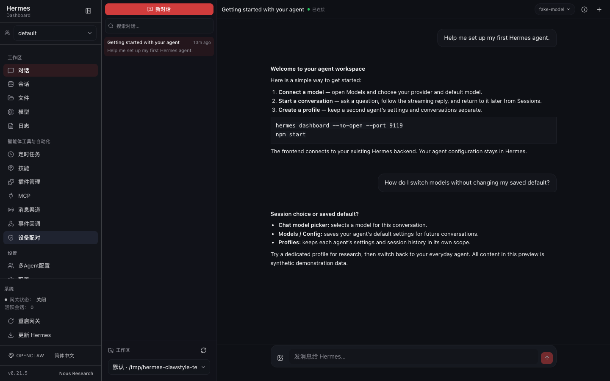

# ClawStyle UI

[English](README.md) | **简体中文**

**为解决 Hermes 原控制面板的易用性问题而打造的 OpenClaw 风格界面，改善字体可读性、信息层级和聊天体验，支持会话管理与 Agent 配置，可作为原 Dashboard 的替代前端。**

**非官方、社区维护的 [Hermes Agent](https://github.com/NousResearch/Hermes-Agent) 仪表盘替代前端。**
沿用同一后端、REST/WebSocket 协议、身份认证与 profile 隔离，重做浏览器体验：原生结构化对话、
可读的系统字体与分组导航。与 Nous Research 及 Hermes Agent 维护者没有隶属、背书或支持关系。

## 界面预览

| 对话 | 模型与配置 |
| --- | --- |
|  |  |

*（截图仅使用合成数据，并启用 ClawStyle 主题。）*

[英文界面](docs/assets/chat-preview.png) · [手机预览](docs/assets/mobile-preview.png) · [截图说明](docs/assets/README.md)

## 为什么再做一个前端？

我们做这个项目，是因为觉得原控制面板不够好用：尤其是原本的装饰性字体，不适合长时间阅读配置和中英文混排。具体来说，标题与标签使用装饰性展示字体，界面密度高、导航是
一条长列表，默认对话基于终端。本项目保留用户依赖的一切——后端、协议、认证与 profile——只重做
浏览器体验：

- **可读性优先。** 界面文本使用中性的系统无衬线字体，并显式加入简中 / 日文 / 韩文回退；代码、
  ID 与可选控制台保持真正的等宽字体。来自设计系统的展示字体工具类会被重映射到当前主题，因此
  可选外部字体加载失败时仍能回退到系统字体。
- **可扫读的导航。** 设置与智能体工具按 `工作区`、`智能体工具与自动化`、`设置` 分组，侧边栏在
  所有路由间保持可折叠的一致状态。
- **原生浏览器对话。** 默认 `/chat` 是结构化 JSON-RPC 客户端：流式回复、工具调用卡、推理折叠、
  审批、clarify 表单、斜杠命令、图片附件与会话级模型切换。对原生对话无法覆盖的交互流程，仍可在
  **System → Open console** 使用可选的 PTY 控制台。
- **配置始终由你掌控。** 安装与启动本前端不会修改后端配置或服务。Config、Keys、Models、Profiles
  页面读写的是上游仪表盘使用的同一套后端配置，但只在你明确保存时写入，并按所选 profile 隔离——
  与上游行为一致。本项目不会静默改写 provider 默认值、密钥或模型。


*相同内容的字体样张，仅比较字体风格，不是上游功能或整页界面对比。*

### 默认主题行为

- **OpenClaw (ClawStyle)** 是新安装以及后端仅报告上游内置默认值时的默认外观；用户已保存的明确
  偏好优先。
- 主题与字体覆盖偏好保存在**后端（整个仪表盘范围）**（`/api/dashboard/theme` 与字体偏好接口），
  并用 `localStorage` 镜像以避免闪烁。它们**不是**按 profile 保存的：切换 profile 不会切换主题，
  所选主题对该后端服务的所有 profile 生效。

## 功能

**原生对话**

- 新建、恢复、搜索、切换会话；按 profile + 会话保存草稿。
- 流式回复、工具调用卡、推理折叠、停止、用量与状态。
- 人工交互：审批（once / session / always / deny）与 clarify 表单（单选、多选、文本、跳过）。
- 斜杠命令（`/new`、`/stop`、`/copy` 本地处理；其余走后端 dispatcher）。
- 图片附件（选择、粘贴、拖拽），作为本轮 turn 的附件提交给后端。
- 会话级模型切换（含昂贵模型确认）；可停止/中断。
- 断线重连并回放事件；未发送草稿与失败发送会恢复，不会丢失。

**仪表盘**

- Sessions、Analytics、Models（用量 + 主模型/辅助任务/MoA 模型设置）、Cron、Skills、Plugins、
  MCP、Profiles（新建/克隆/重命名/删除、SOUL.md、按 profile 设置模型）、Config（表单 + 原始
  YAML）、Keys（`.env` + OAuth 登录）、Channels、Webhooks、Pairing、Logs、Files、System、Docs。
- Profile 切换器：所有管理页面跟随所选 profile，保留 profile 隔离。

**主题**

- 内置主题：**OpenClaw (ClawStyle)**、Hermes Teal、Hermes Teal Large、Nous Blue、Midnight、
  Ember、Mono、Cyberpunk、Rosé。
- 精选字体覆盖目录（无衬线/衬线/等宽），全部以系统回退结尾。仓库不分发 Web 字体二进制；目录中的
  字体仅在用户选择时由浏览器按需加载。

## 运行要求

- **Node.js `^22.22.0 || ^24.11.0 || >=26.0.0`**
- **npm `<11.10.0 || >=11.17.0`**（使用 `npm ci` 安装锁文件）
- **正在运行的 Hermes Agent 仪表盘后端。** 本前端自身不提供数据服务：它把 `/api`、
  `/dashboard-plugins` 与 WebSocket 代理到后端，并依赖后端仪表盘 HTML 注入一次性会话 token。

### 后端兼容性

已在公共上游 Hermes Agent commit
[`2f80ae0a6a91932b1808a53f9c55f8b3f313d6cc`](https://github.com/NousResearch/hermes-agent/commit/2f80ae0a6a91932b1808a53f9c55f8b3f313d6cc)
（2026-10-02）上验证：仪表盘 REST API、JSON-RPC/WebSocket 网关与配置持久化，且 `web_server.py`
与 `tui_gateway` 未被修改。更新的 Hermes Agent commit 尚未验证，请结合实际后端复核。证据说明见
[docs/ATTRIBUTION.md](docs/ATTRIBUTION.md#compatibility)。

本仓库的 Node 源码基于上游 `web/` 目录的**本地**快照 `48799de49`；该快照标识不是公共上游 commit。

独立服务器**不能**无后端运行：它需要抓取后端自己的仪表盘 HTML 来注入 `window.__HERMES_*` 引导值
（含会话 token）。后端不可达，或返回 200 但不含这些值（例如 headless 服务）时，页面仍能打开，但
API 调用会失败。界面横幅与 `GET /healthz` 会报告该状态；`/healthz` 在后端不可达或缺少引导值时
均返回 503。

## 快速开始

### 1. 启动后端

先安装并运行 Hermes Agent 后端（独立项目），例如：

```bash
hermes dashboard          # 在上游仪表盘 http://127.0.0.1:9119 提供服务
```

`hermes serve` 是 headless 模式，不提供本前端所需的 `window.__HERMES_*` 引导值。

### 2. 获取并安装前端

```bash
git clone https://github.com/LuwenOosten/clawstyle-ui.git
cd clawstyle-ui
npm ci
```

### 3. 构建并运行（生产式本地服务器）

```bash
npm run build             # 输出 ./dist
npm start                 # http://127.0.0.1:9130（独立服务器）
```

### 4. 验证

```bash
curl -s http://127.0.0.1:9130/healthz | jq
# 预期 "ok": true 且 "backend": { "ok": true, "bootstrap": true, ... }
```

### 开发模式（可选）

改界面时使用 Vite 开发服务器，默认端口与独立服务器一致，支持热更新与同样的代理：

```bash
npm run dev               # http://127.0.0.1:9130；代理目标 HERMES_DASHBOARD_URL
```

开发服务器会读取后端 `index.html` 转发会话 token 引导；请先启动后端，否则控制台会提示 `/api`
将返回 401。可用 `HERMES_CLAWSTYLE_DEV_PORT` 覆盖开发端口（测试用它避免端口冲突）。

### 工作区检查

```bash
npm run check             # typecheck + lint + 测试 + 构建
```

## 配置

| 变量 | 默认值 | 说明 |
| --- | --- | --- |
| `PORT` | `9130` | 独立服务器监听端口，必须与后端端口不同；若 `HERMES_DASHBOARD_URL` 指向前端自身端口会被拒绝。 |
| `HERMES_DASHBOARD_URL` | `http://127.0.0.1:9119` | 后端地址（仅 loopback）。`npm start`、`npm run preview` 与 `npm run dev` 代理都使用它。 |
| `HERMES_CLAWSTYLE_DEV_PORT` | `9130` | Vite 开发服务器端口（`strictPort`），仅开发模式。 |
| `HERMES_CLAWSTYLE_DIST` | `./dist` | 独立服务器提供的构建目录。 |
| `HERMES_CLAWSTYLE_HOST` | `127.0.0.1` | 独立服务器监听地址（仅 loopback）。 |
| `HERMES_CLAWSTYLE_ALLOWED_HOSTS` | *(空)* | 额外信任的 `Host`/`Origin`，例如 `tailscale serve`。逗号分隔；裸主机名自动补 `PORT`。 |

后端在非默认 loopback 端口上的示例：

```bash
HERMES_DASHBOARD_URL=http://127.0.0.1:9199 PORT=9130 npm start
```

完整变量（含部署期覆盖项）见 [docs/GETTING_STARTED.zh-CN.md](docs/GETTING_STARTED.zh-CN.md)。

## 部署

### 手动运行（macOS / Linux）

```bash
npm ci
npm run build
PORT=9130 HERMES_DASHBOARD_URL=http://127.0.0.1:9119 npm start
```

用你常用的进程守护方式保持运行（`systemd --user`、`launchd`、`pm2` 等）。独立服务器只提供构建产物
并代理到后端，不会修改后端配置或原版仪表盘。

### 可选：macOS LaunchAgent

`ops/deploy.mjs` 会把构建好的 `dist/` 与独立服务器快照到版本化目录，原子切换 `current` 符号链接，
并管理用户级 LaunchAgent（`local.hermes.clawstyle-ui`）。它拒绝管理不属于自己的目录或 plist，也只
操作自己的 launchd 服务；若上游 URL 与前端监听端口相同，会拒绝安装。

```bash
npm run build
node ops/deploy.mjs install --dist dist     # 加 --skip-service 可跳过 LaunchAgent 重载
node ops/deploy.mjs check                   # 健康检查（加 --json 输出机器可读结果）
node ops/deploy.mjs rollback                # 或 --to <version>
```

### 恢复原版仪表盘

停止本前端，直接打开后端即可，无需其他改动：

```bash
# 前台 `npm start` 按 Ctrl+C，或者：
launchctl bootout gui/$(id -u)/local.hermes.clawstyle-ui   # macOS LaunchAgent
# 然后打开未被改动的上游仪表盘：
open http://127.0.0.1:9119
```

## 已知限制

- **不支持原生 Windows。** 独立服务器与部署脚本面向 macOS/Linux（POSIX）；WSL 未验证。
- **原生对话不含终端交互。** 仅 PTY 可做的交互流程——`sudo`/密钥提示、vault、浏览器预览、原始终端
  读取——会明确失败并提示改用终端。系统页提供 **Open console** PTY 控制台，上游仪表盘与 CLI 同样可用。
- 上游的旧版终端聊天页在本构建中未注册路由；默认 `/chat` 为原生对话体验。构建仍会为可选的系统
  控制台产出 xterm chunk。
- 仅支持图片附件；后端已有的文件/PDF 附件 API 未接入界面。
- 运行中的 turn 需要先停止才能发送下一条（后端支持排队，界面暂未做）。
- 历史一次加载（`session.history` 无分页参数），超长会话数据量较大。
- 独立服务器仅监听 loopback，并拒绝把上游代理指向自身监听端口。
- 对话与仪表盘功能依赖后端版本的 API，见[后端兼容性](#后端兼容性)。

## 文档

- [docs/GETTING_STARTED.zh-CN.md](docs/GETTING_STARTED.zh-CN.md) — 安装、运行、配置、健康检查与排错
  （英文版：[docs/GETTING_STARTED.md](docs/GETTING_STARTED.md)）
- [docs/AGENT_SETUP.zh-CN.md](docs/AGENT_SETUP.zh-CN.md) — 可直接粘贴给 AI 编码代理的安装提示词，
  以及模型、provider、profile 配置管理指南（英文版：[docs/AGENT_SETUP.md](docs/AGENT_SETUP.md)）
- [docs/ATTRIBUTION.md](docs/ATTRIBUTION.md) — 上游署名、第三方许可证与兼容性说明
- [CONTRIBUTING.md](CONTRIBUTING.md) — 贡献流程、检查项与约定

[验收结果与已知边界](docs/VALIDATION.zh-CN.md)

## 许可证

MIT — 见 [LICENSE](LICENSE)。仪表盘前端源自上游 Hermes Agent `web/` 目录，Copyright (c) 2025 Nous
Research，并保留上游 MIT 声明。第三方组件与浏览器按需加载的字体遵循各自许可证，见
[docs/ATTRIBUTION.md](docs/ATTRIBUTION.md)。
